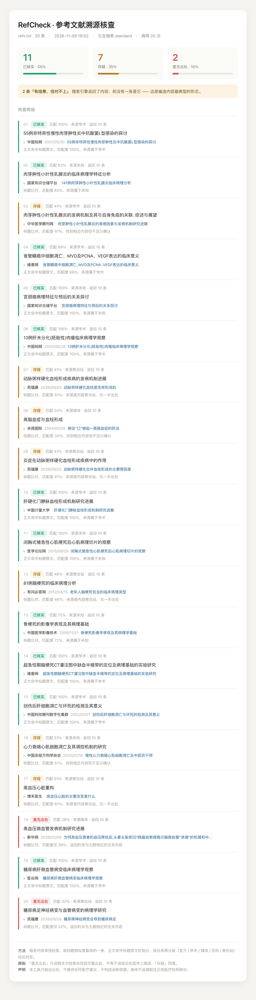

# RefCheck · 医学信息溯源核查器

把 AI 说出的每一句医学陈述、每一条参考文献，逐条拿去元宝搜索查出处，给出一份可点开核对的报告。

**它不做诊断，不判断医学结论对错，只验证"这句话背后有没有出处"。**



*用 20 条 AI 生成的病理学参考文献跑出来的结果：11 条可溯源、7 条存疑、2 条查无出处。*

---

## 为什么会有这个东西

女朋友在读护理专业，这学期要交病理学实验报告。她图省事，让 AI 帮着列了一版参考文献——标题像模像样、期刊名专业、年份合理、卷号页码齐全，格式上挑不出任何毛病。

但没人知道这些文献是不是真的。

我用元宝搜索做了个工具，让她引用之前先过一遍。写着写着发现，这不只是学生的事：**AI 给你写的任何东西，只要涉及"事实"，都该有出处。** 热搜上医生用 AI 查药、患者拿 AI 结论质疑医生的争议，本质是同一件��——谁都不知道 AI 说的那句话能不能验证。

---

## 快速开始

> 想了解「别人怎么用这个项目」——包括零门槛看效果、接自己的资料、改成其他领域——见 **[USAGE.md](USAGE.md)**。

不需要装任何第三方库，Python 3.8+ 直接跑。

```bash
git clone <repo>
cd refcheck

export TENCENTCLOUD_SECRET_ID=你的SecretId
export TENCENTCLOUD_SECRET_KEY=你的SecretKey

# 核查一份参考文献列表
PYTHONPATH=src python3 -m refcheck refs -i refs.txt -r out

# 核查一段医学问答
PYTHONPATH=src python3 -m refcheck claims -i answer.txt -r out
```

输出三样东西：

- 终端报告（带颜色，分级条）
- `out/references_report.html` 或 `out/claims_report.html`（单文件，可直接截图分享）
- `out/*_result.json`（结构化结果，供二次统计）

### 依赖的服务

腾讯云元宝搜索（云 API 3.0，`wsa.tencentcloudapi.com` / `SearchPro`）。

⚠️ **必须用标准版**：极速版不支持 `Industry`、`Cnt`、`score`，没有 `Industry=acad` 就限定不了学术信源，整个核查逻辑会失效。
⚠️ 个人账号的活动额度只覆盖极速版和标准版，**拿不到 `authority_level`**（仅旗舰版返回），所以本项目的来源权威度是**自建域名白名单**，不依赖官方字段。

---

## 两套判据，因为"像"不是一回事

### 参考文献 → 比标题

要找的是"这一篇"，标题对得上才算数。

1. 解析 GB/T 7714 格式，拆出标题 / 期刊 / 年份
2. 拿标题 + 期刊去搜
3. 取标题相似度最高的一条，正文里出现标题原文时加权
4. 三档：**已核实 / 存疑 / 查无出处**

聚合站（内容农场）和百科即使标题完全一致，也**不允许判"已核实"**——它们本身没有一手出处。

### 医学陈述 → 比实体覆盖

一个句子永远不可能和一篇文章标题相似，所以这里不能比标题。

1. 从句子抽出关键实体：药名、指标、疾病、药物类别
2. 拿实体组合去搜
3. 看返回的正文覆盖了多少实体
4. 三档：**有出处 / 弱支撑 / 未找到**

术语刻意克制：覆盖到实体只说明"有资料讨论这些事"，不等于"这份资料支持这个结论"。

---

## 实测中发现的三件事

这些都是"不真调一遍 API 就不会知道"的细节：

**1. `Response.Pages` 是 JSON 字符串数组**

不是对象数组。每个元素都得再 `json.loads()` 一次，直接当字典用会拿到一串字符串。

**2. `score` 不是稳定的 0~1**

官方文档写"取值 0～1"，实测同一个 query 两次调用分别返回 `0.777` 和 `3.832`。所以判定不能用绝对分数阈值，只能做排序参考。

**3. "搜不到"不等于"没结果"**

一条编造的文献照样能返回 10 条结果——搜索引擎会把主题相近的内容给你。真正的判据是标题/实体对不对得上，不是 `len(results) > 0`。

报告里专门统计了这类"有结果、但对不上"的条目，那正是编造内容最典型的样子。

---

## 局限（诚实版）

- 陈述核查靠实体覆盖，**只说明有资料讨论这些事，不证明结论成立**；断言方向（升高/降低）没有校验
- 实体抽取用后缀词表，不依赖分词库，罕见的药名、缩写、英文药名会漏
- 「查无出处」只代表本次检索未找到可靠出处，不等于结论错误
- 判定准确率依赖搜索结果质量，冷门文献覆盖会差
- 来源分级是人工维护的白名单，必然有遗漏

---

## 目录结构

```
src/refcheck/
  tc3.py        腾讯云 TC3-HMAC-SHA256 签名（标准库实现）
  client.py     SearchPro 封装：Pages 解析、去重、错误翻译
  extract.py    参考文献解析 + 医学陈述抽取
  authority.py  来源分级：官方 / 学术 / 媒体 / 百科 / 聚合站
  match.py      相似度与三档判定
  check.py      核查流程与统计
  report.py     单文件 HTML 报告
  render.py     终端报告
  cli.py        命令行入口
tests/          49 个单元测试，全部离线
```

---

## 免责声明

本工具输出仅供参考，**不构成任何医疗建议，不可作为诊断或用药依据**。身体不适请及时前往正规医疗机构就诊，遵医嘱。

工具只验证出处，不判断医学结论对错。

---

## License

MIT
